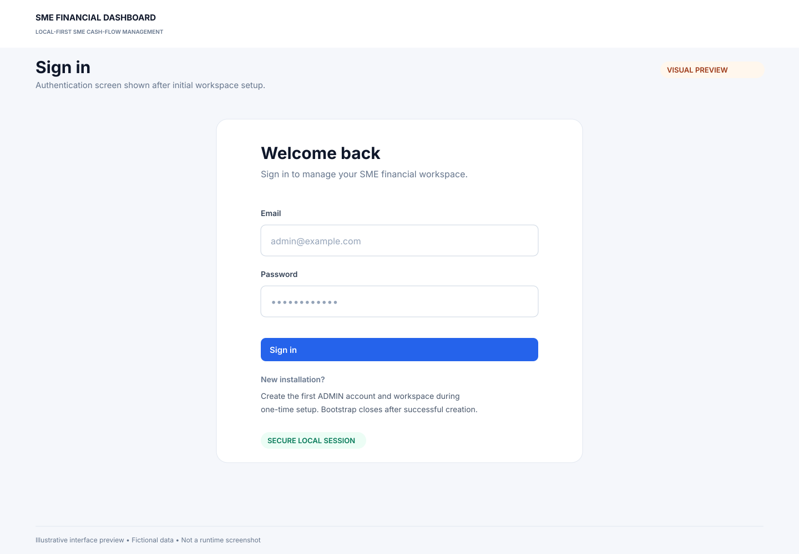
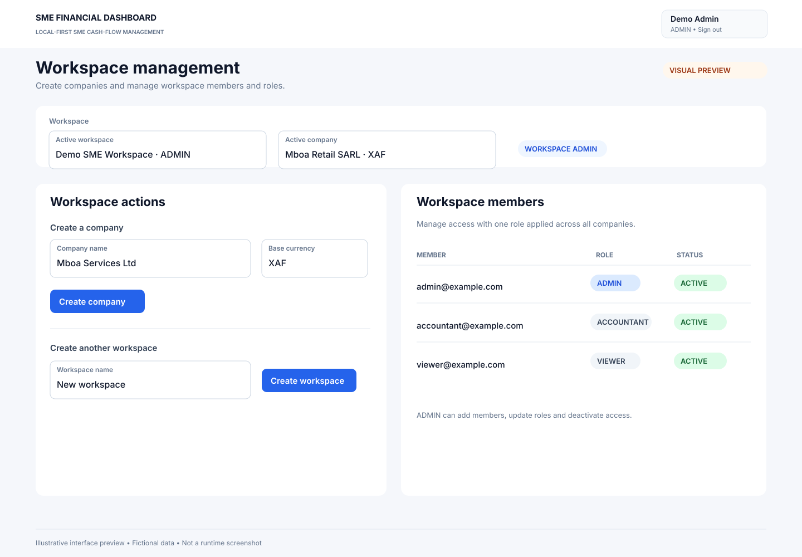
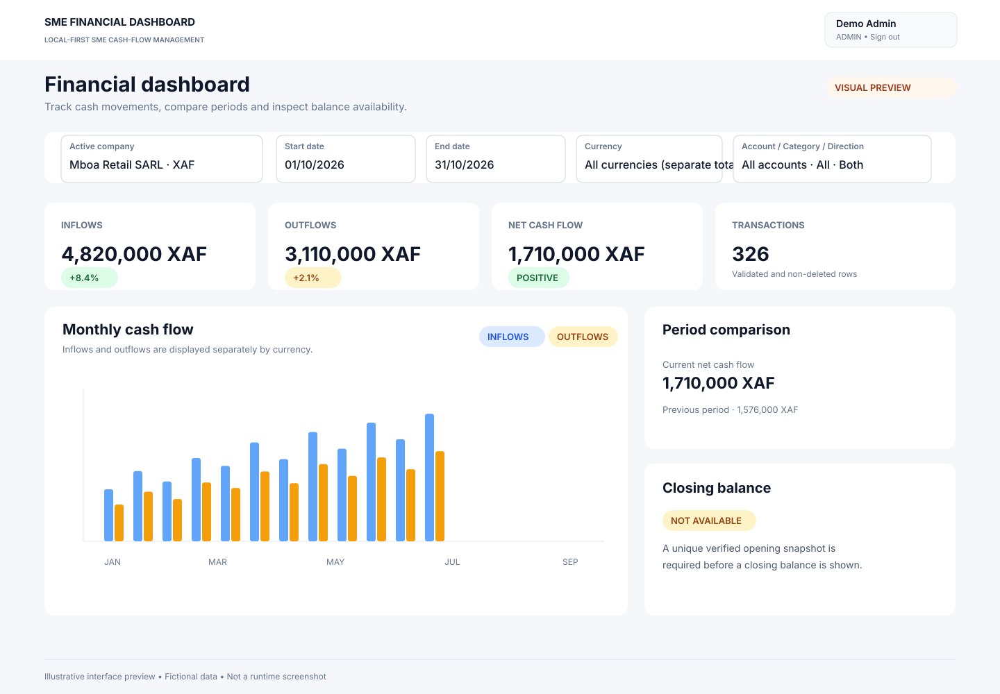
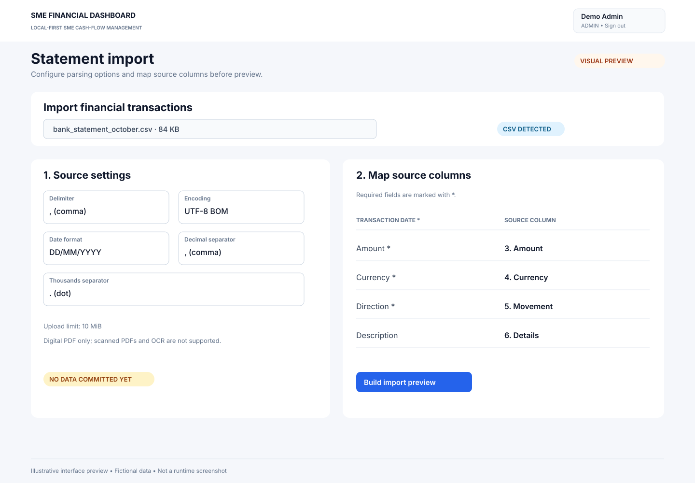
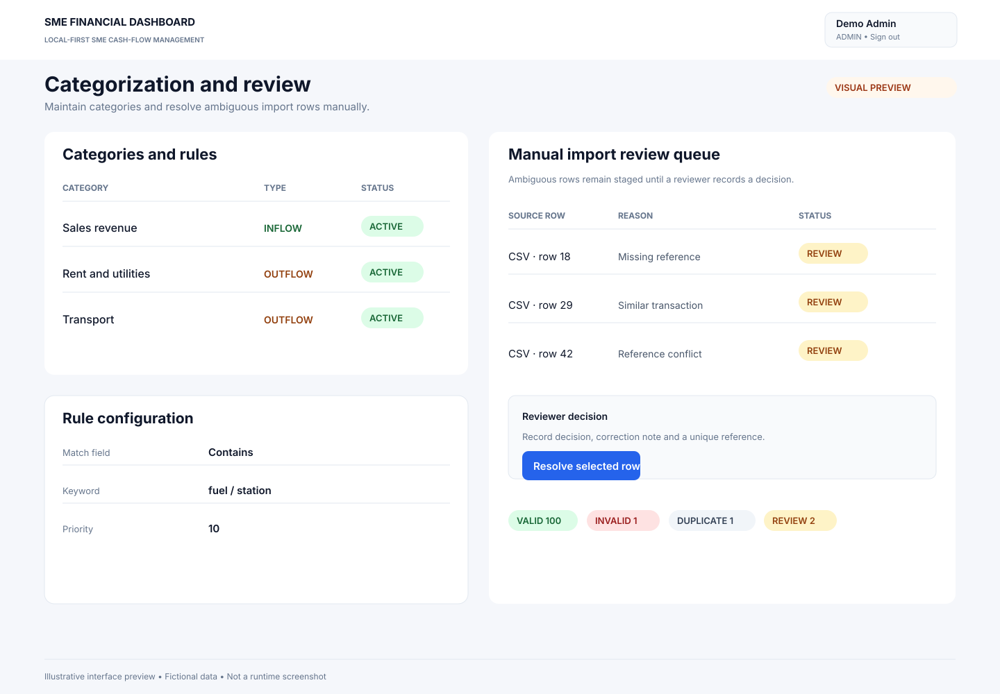
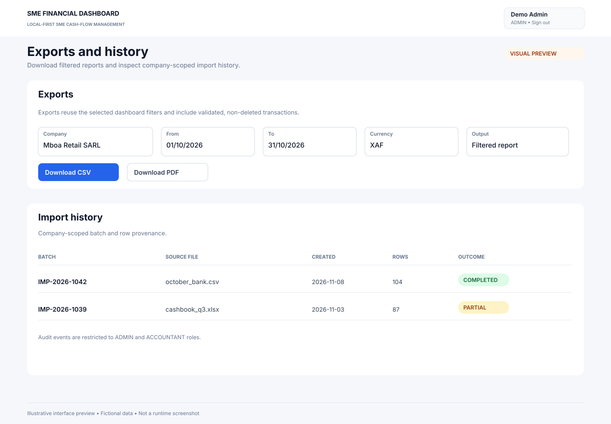

# SME Financial Dashboard

A local-first MVP that turns SME bank statements and sales/expense exports into traceable cash-flow management information. It is **not** certified accounting software and does not replace statutory books, tax advice or a bank statement.

## Interface previews

The following visual previews illustrate the main workflows currently implemented in the Streamlit application. They use fictional data and are **not direct browser captures**; final runtime screenshots should replace them after the manual browser visual QA gate is completed.

| Sign-in | Workspace and members |
|---|---|
|  |  |

| Financial dashboard | Statement import |
|---|---|
|  |  |

| Categories and manual review | Exports and history |
|---|---|
|  |  |


## Approved MVP boundaries

- Input formats: CSV, XLSX and text-based/digital PDF statements.
- PDF extraction uses text/table extraction only. Scanned/image-only PDFs, OCR, encrypted PDFs and embedded-file extraction are out of scope for the MVP.
- Positive `Decimal` amounts with explicit `INFLOW` / `OUTFLOW` direction.
- No automatic FX conversion; figures are partitioned by ISO 4217 currency.
- Workspace membership supplies one role (`ADMIN`, `ACCOUNTANT`, `VIEWER`) uniformly across companies in that workspace.
- `ADMIN` and `ACCOUNTANT` can soft-delete transactions with a reason; only `ADMIN` can restore.
- Ambiguous import rows remain in `REVIEW`. After explicit confirmation, valid rows may be committed while review rows remain staged.
- One primary category per transaction.
- Closing balance is unavailable without a reliable opening snapshot.

See `docs/` for the approved scope, architecture, data dictionary, threat model and acceptance criteria.

## Requirements

- Python 3.11, 3.12 or 3.13
- Windows 10/11, Linux or WSL2
- SQLite for the local single-instance MVP

## Installation (Windows / WSL2)

**Requirements:** Python 3.11–3.13.

### 1. Download the project

```bash
git clone --branch feat/phase-7-qa-tooling https://github.com/Fred4real3times/SME_Financial_Dashboard.git
cd SME_Financial_Dashboard
```

### 2. Create and activate the virtual environment

**Windows PowerShell**
```powershell
py -3.11 -m venv .venv
.\.venv\Scripts\Activate.ps1
```

**WSL2 / Linux**
```bash
python3 -m venv .venv
source .venv/bin/activate
```

### 3. Install and configure

Run these commands on either platform:

```bash
python -m pip install --upgrade pip
python -m pip install -e ".[dev]"
```

Create the local configuration file:

**Windows PowerShell**
```powershell
Copy-Item .env.example .env
```

**WSL2 / Linux**
```bash
cp .env.example .env
```

Generate a session secret:

```bash
python scripts/generate_session_secret.py
```

Copy the value displayed into `.env` after `SESSION_SECRET=`. Keep `.env` private; never commit it.

### 4. Initialize and launch

```bash
alembic upgrade head
streamlit run app.py
```

Open the local URL displayed by Streamlit. The default SQLite database is created automatically under `.data/`.
  
## Database

The default database URL is `sqlite:///./.data/sme_financial_dashboard.db`. The directory is created automatically. The installation steps above apply the required migrations.

## Tests and lint

```bash
pytest
ruff check .
ruff format --check .
```

## Current implementation status

The current development branch contains the approved local-first MVP workflows: authentication and workspace/company management; CSV/XLSX/digital-PDF import preview, validation and confirmed partial commit; REVIEW resolution; categorization rules; currency-separated dashboard and conditional opening-balance calculations; filtered CSV/PDF exports and history; synthetic SME data; SQLite backup/restore; verified-snapshot uniqueness; and time-bounded parser execution.

`main` and the development branch remain separate until the open pull request is merged. Automated CI does not replace clean Windows/WSL installation, interactive CLI, browser visual/workflow testing, manual restore or independent security review. The application remains a local single-instance SQLite MVP, not certified accounting software or a hosted multi-user platform.

## Security notes

- Do not place bank passwords, PINs, API keys or real customer data in the repository.
- `.env` and local database files are ignored by Git.
- Uploaded content is untrusted. Parsers must be bounded, and PDF actions/macros are never executed.
- SQLite has no row-level security. Every application query must enforce server-side company scope. Hosted/concurrent deployment requires PostgreSQL and a separate security review.


## First run and authentication

1. Apply migrations: `alembic upgrade head`.
2. Generate a unique local secret: `python scripts/generate_session_secret.py`.
3. Put the generated value in `.env` as `SESSION_SECRET=...`. Never commit `.env`.
4. Start the app: `streamlit run app.py`.
5. On an empty database, create the one-time first ADMIN and its workspace. The initial setup endpoint is then permanently closed by a singleton database record.
6. Sign in. The ADMIN can create companies and manage members/roles from Workspace Management.

Sessions are opaque HMAC-SHA256 signed tokens held in Streamlit server-side session state and backed by revocable database records. They expire after `SESSION_TTL_HOURS` (default 12 hours); logout revokes the current session. This is not an external SSO or persistent browser-cookie integration. In production, use a unique secret of at least 32 characters and protect the host/database.


## Statement import (Phase 3)
The import workflow accepts CSV, XLSX and digital/text-based PDF statements. Uploads are capped at 10 MiB both in Streamlit and in the parser; XLSX archives at 1,000 entries, 50 MiB expanded size and 200:1 compression ratio; PDF files at 100 pages, 50 tables per page, 250,000 extracted characters per page and 5,000,000 per document; and imports at 10,000 rows / 100 columns. CSV delimiter/encoding, XLSX worksheet, date format, decimal and thousands separators and direction convention are explicitly selected. XLSX formula cells are rejected; macros are not run. Scanned/image-only or encrypted PDFs are unsupported (no OCR).

The preview stores sanitized staging rows only. No financial transaction is created until the user confirms the import. A separate partial-import confirmation is required when invalid, duplicate or REVIEW rows are present. Only valid rows are committed; ambiguous reference-less matches remain in REVIEW. Imported amounts are Decimal, positive, and never automatically converted between currencies.


### Verification snapshot
Phase 3 branch head 64e50231bf228e251fb529b20655b89eba62b6cf passed GitHub Actions run 42621129042 on Python 3.11, 3.12 and 3.13 (76 tests per version, Ruff and migration round-trip). The branch is delivered as draft PR #2 stacked on Phase 2; it is not merged into main. Manual browser smoke testing remains part of final QA.


### Phase 3 QA hardening
CSV rows are streamed; XLSX ZIP entry, expanded-size, compression-ratio and column limits are checked; PDF encryption, table widths, page/table/row/character bounds are checked. SQLite duplicate lookups are chunked and transaction commits batch inserts before linking staged source rows. Statement extraction runs in a disposable child process with a 30-second wall-clock limit. The worker is terminated on timeout. This is not an OS sandbox or memory quota; keep the application local and do not expose upload parsing as a public service.


## Categories, rules and manual import review (Phase 4)
Transactions support one primary category. Rules match description keywords, counterparty or reference; higher numeric priority wins, while equal top-priority matches remain unclassified for manual attention. A manual category assignment is audited and is not overwritten by rules. Confirmed imports apply applicable rules in the same transaction as the import.

Ambiguous import rows stay in the REVIEW queue until an ADMIN or ACCOUNTANT records a decision. A corrected acceptance requires a reviewer note and a unique manual reference. The original source fingerprint is retained so re-importing the same reference-less row returns to REVIEW rather than silently inserting it again.


### Current integration and verification snapshot — 2026-11-09
- Phase 3 import engine, Phase 4 categorization/manual REVIEW, and the Ruff correction are integrated into \`main\`.
- Current main commit at this snapshot: \`41cf26cb5231ceb3e540f402fb9b944048a2315e\`.
- Post-merge GitHub Actions run [42634994455](https://github.com/Fred4real3times/SME_Financial_Dashboard/actions/runs/42634994455) passed on Python 3.11, 3.12 and 3.13; each matrix job passed Ruff, 110 tests, Alembic round-trip and SQLite foreign_key_check.
- Manual browser-based Streamlit smoke testing and independent external security review remain outstanding.
- Phase 5 dashboard work is in progress. The dashboard excludes soft-deleted and unvalidated transactions, keeps Decimal calculations per currency, and only displays closing balance when a unique verified account/currency opening snapshot supports it.


### Phase 5 dashboard verification — 2026-11-09
The Phase 5 dashboard branch head \`62eb759f2c5c480a7b7385d6939d1d7377bc398e\` passed GitHub Actions run [42637974318](https://github.com/Fred4real3times/SME_Financial_Dashboard/actions/runs/42637974318): Python 3.11, 3.12 and 3.13 each passed Ruff, 120 tests, Alembic upgrade/check/downgrade/re-upgrade and SQLite foreign_key_check. PR #6 remains a draft. Manual browser smoke testing and independent security review remain open.


### Phase 6 — Exports and history (implementation in progress)
The Phase 6 branch adds filtered CSV/PDF export, spreadsheet-formula neutralization, company-scoped import batch/row history and restricted audit history. Exports reuse the exact dashboard filters and include only validated, non-deleted transactions. Automated verification and release status will be recorded after the branch-head CI completes.


### Phase 6 automated verification — integrated into main
Follow-up PR #10 [fixes the Streamlit history headings and CI/test expectations](https://github.com/Fred4real3times/SME_Financial_Dashboard/pull/10) and is merged. Main commit \`bead79a0cb5930cd6e63eb5674ab9c2a91a3ef15\` passed post-merge GitHub Actions run [42647921772](https://github.com/Fred4real3times/SME_Financial_Dashboard/actions/runs/42647921772): 136 tests per Python 3.11/3.12/3.13 matrix job, Ruff, Alembic round-trip and SQLite foreign_key_check. Manual browser visual testing and independent external security review remain open.

### Phase 7 — Synthetic QA dataset
Create a separate fictional SQLite demo database (never overwrite an existing database):

\`\`\`powershell
python scripts/generate_synthetic_data.py --confirm-synthetic-only
\`\`\`

The script prompts for a synthetic ADMIN password and creates three SMEs (retail, services, manufacturing) with 12 months of XAF activity and quarterly USD bank-fee rows. Each company has 100 valid transactions plus one INVALID, one DUPLICATE and two reference-less REVIEW rows. Only VALID rows are committed; held rows remain in import history. The default output is \`.data/sme_financial_dashboard_synthetic.db\`.

### SQLite backup and restore

\`\`\`powershell
python scripts/sqlite_backup_restore.py backup --source .data/sme_financial_dashboard_synthetic.db --destination .data/backups/sme-synthetic-backup.db
python scripts/sqlite_backup_restore.py restore --backup .data/backups/sme-synthetic-backup.db --destination .data/sme_financial_dashboard_synthetic.db --replace-existing
\`\`\`

Restore only after stopping Streamlit. The command verifies SQLite integrity and foreign keys and prints a SHA-256 checksum. Backups contain confidential financial and authentication data; the utility does not encrypt them. Store them on protected/encrypted storage.


### Phase 7 verification — automated feature-branch evidence
The Phase 7 synthetic dataset and SQLite backup/restore work on branch \`feat/phase-7-qa-tooling\`, head \`4687979753a7f6f4f444f2b541eac965a6d3cd2c\`, passed GitHub Actions run [42651239061](https://github.com/Fred4real3times/SME_Financial_Dashboard/actions/runs/42651239061): Ruff, 142 tests per Python 3.11/3.12/3.13 job, Alembic round-trip and SQLite foreign_key_check. Per SME profile, 100 valid transactions are committed and the 4 noisy rows remain held (1 INVALID, 1 DUPLICATE, 2 REVIEW). This is feature-branch evidence pending review/merge. The interactive CLI has not been run manually; browser visual QA and independent external security review remain open.


The Phase 7 QA report is historical evidence for the implementation commit it reviewed. The current Phase 7–8 candidate is recorded below; automated CI has passed on its exact branch head. Manual release gates remain separate.

## Release-candidate status — 2026-11-09

- Candidate branch: `feat/phase-7-qa-tooling`; exact head: `ea4036801dd3041a3a1d689f38d3289201fefbfb`.
- Exact-head GitHub Actions run [42670582232](https://github.com/Fred4real3times/SME_Financial_Dashboard/actions/runs/42670582232) passed: 148 tests on Linux Python 3.11, 3.12 and 3.13, and Windows Python 3.11; Ruff, Alembic migration round-trip and SQLite foreign-key checks also passed.
- Phase 7 synthetic data and SQLite backup/restore, plus Phase 8 verified-snapshot uniqueness and parser time limits, have automated test coverage.
- **Not yet release-approved:** clean Windows and WSL2 installation, interactive synthetic CLI, manual browser workflow/visual QA, manual backup/restore, and independent external security review are still required.
- Keep use local and single-instance with SQLite. Do not expose the Streamlit app publicly. Backup data must be stored on encrypted, access-controlled storage.
